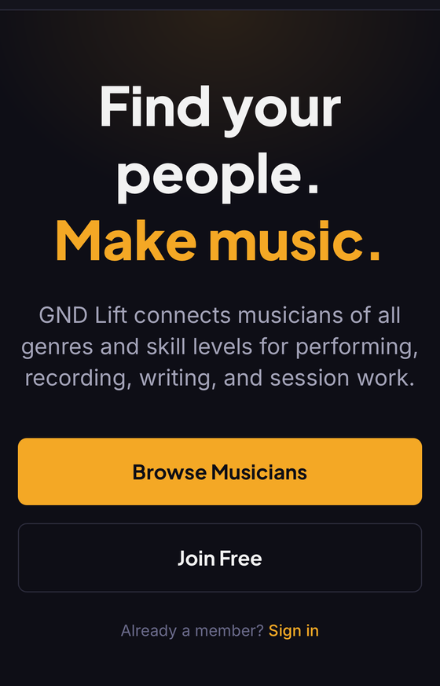
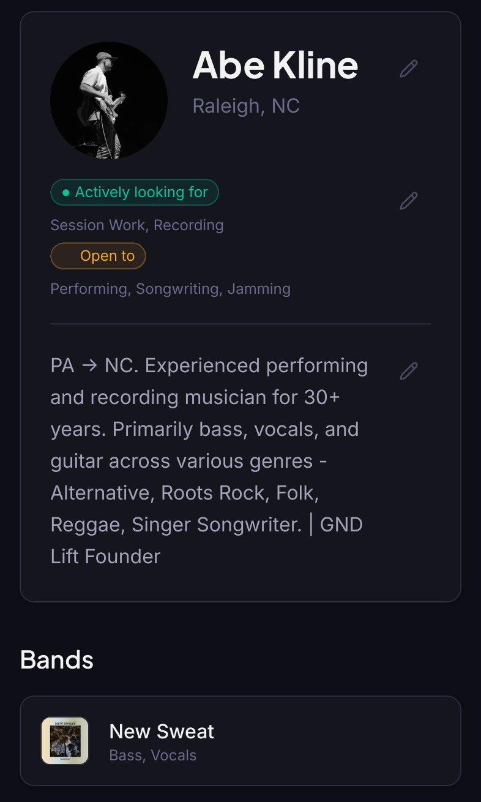
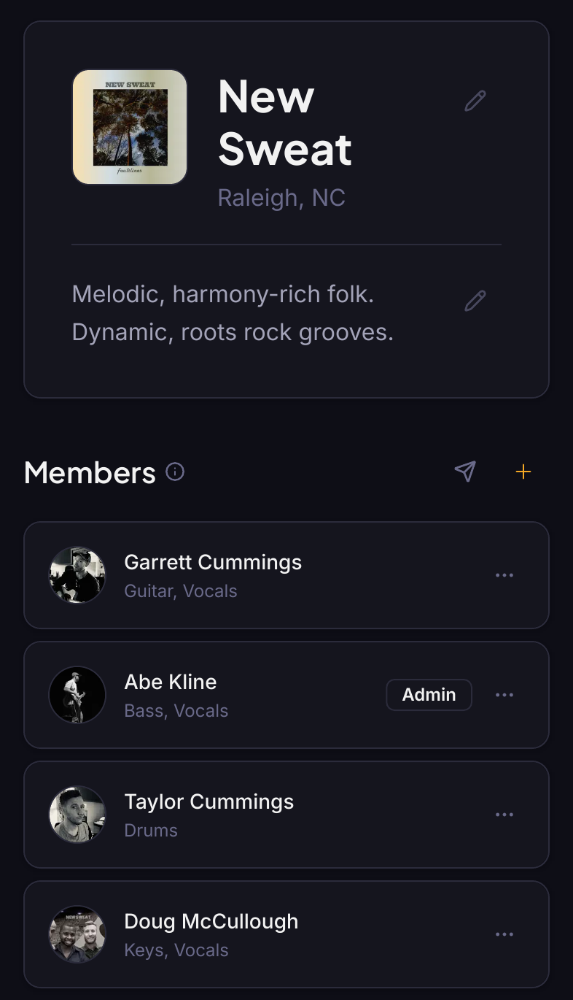
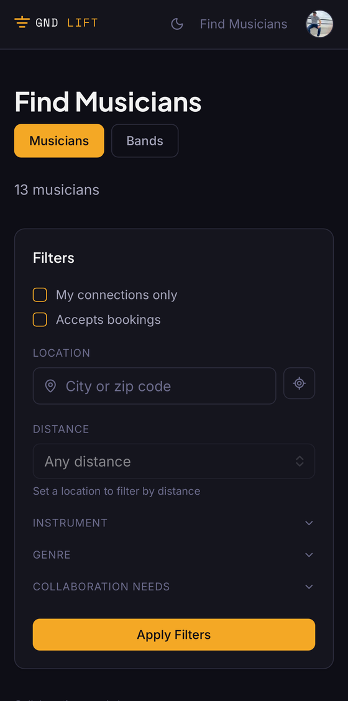

# GND Lift

**Live app:** [gndlift.com](https://gndlift.com/)

GND Lift is a social platform for musicians — a place to build a profile, showcase your bands and discography, and find people to perform, record, write, or do session work with.

*Landing page — the pitch: find your people, make music.*

*Musician profile — bio, availability, and linked bands.*

*Band page — members, roles, and discography, shown here for New Sweat.*

*Find Musicians — filter by instrument, genre, location, and collaboration needs.*

## Features

**Profiles & bands**

- **Musician profiles** — instruments with skill level, genres, gear, bio, and external links (streaming platforms, socials)
- **Band pages** — member rosters and roles, "looking for" roles, engagement type, and band media
- **Band invites** — shareable token-based invite links for adding members, with expiry
- **Shareable pages & QR codes** — public profile and share pages that are easy to pass along

**Music history**

- **Discography & credits** — albums and singles with streaming links and per-track credits (member, session, featured), including an invitation flow so collaborators can confirm their credit
- **Shows** — upcoming and past show listings with per-show member credits; band admins can connect Bandsintown to sync events in automatically

**Discovery & networking**

- **Search** — filter musicians by instrument, genre, experience, availability, and location radius (haversine distance); band search by the roles they need
- **Connections** — connection requests, a mutual network, and a connections-only search filter
- **Endorsements** — request and give skill endorsements with connected musicians
- **Messaging** — real-time one-on-one conversations with unread indicators
- **Booking inquiries** — an optional "Contact for Booking" flow with a per-user inbox, plus a shareable review link for outside work

**Platform**

- **Notifications** — in-app and transactional email (welcome, connection and endorsement activity, messages, booking, credit invitations, and a daily summary), with per-user preferences
- **Trust & safety** — blocking and content reporting, plus rate limiting on sensitive endpoints
- **Onboarding** — guided first-run flow and in-app product tour
- **Admin tools** — an admin panel, including an impersonation mode for support

## Tech Stack

- **Frontend:** Next.js (App Router), React, and TypeScript, with Tailwind CSS and shadcn/ui
- **API / Auth / DB:** Supabase — Postgres with row-level security, Google OAuth, and file storage for avatars and media
- **Email:** Resend (React Email templates)
- **Rate limiting:** Upstash Redis
- **Deployment:** Vercel
- **Quality:** Vitest and React Testing Library for unit tests; Playwright end-to-end tests across desktop and mobile browsers; automated WCAG 2.1 AA accessibility scans (axe-core) in CI

## Background

GND Lift grew out of a simple observation from years of playing in bands: finding collaborators — a fill-in drummer, a co-writer, someone for session work — usually comes down to word of mouth or scattered social media posts. GND Lift centralizes that into searchable profiles and bands, using my own musical background (and New Sweat's discography) as the first real content on the platform.
